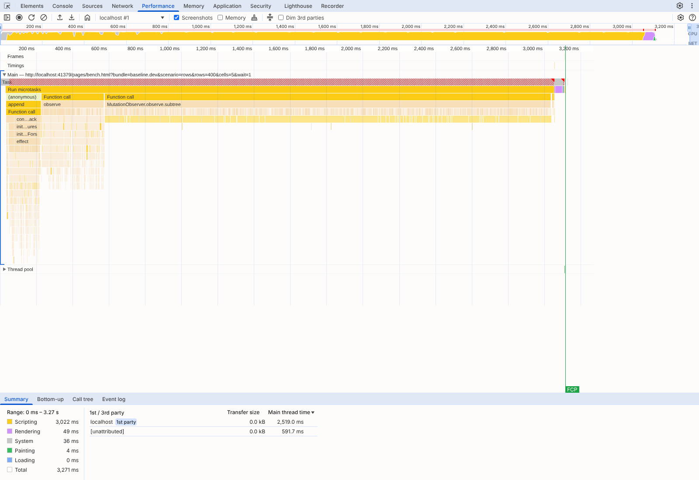
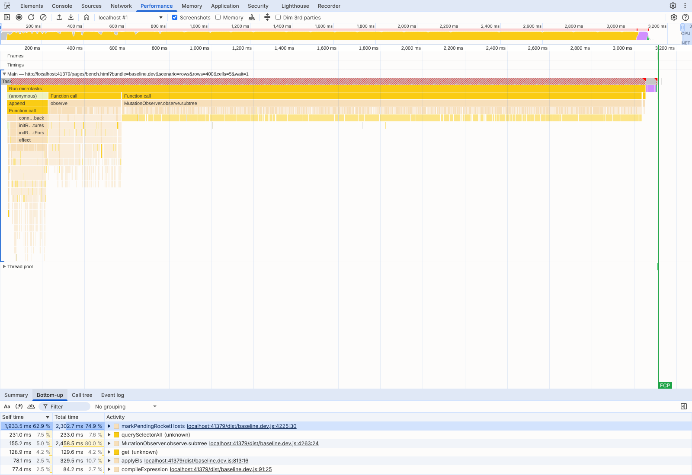
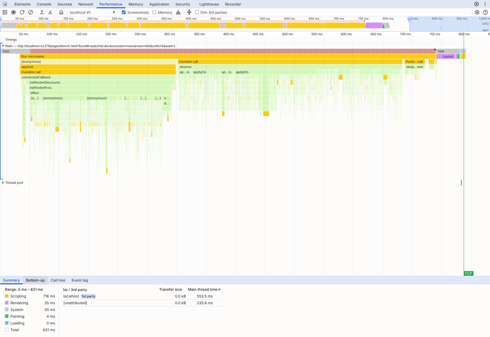
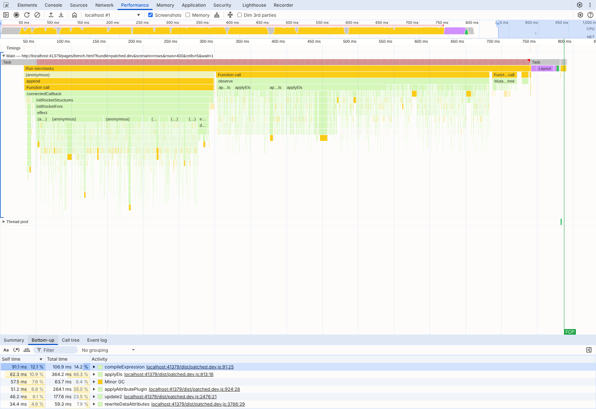
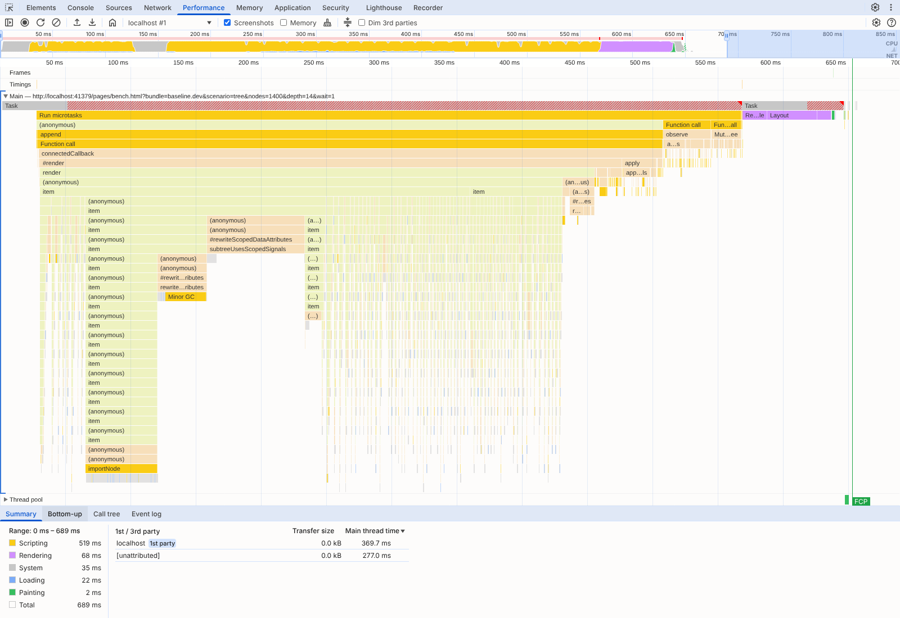
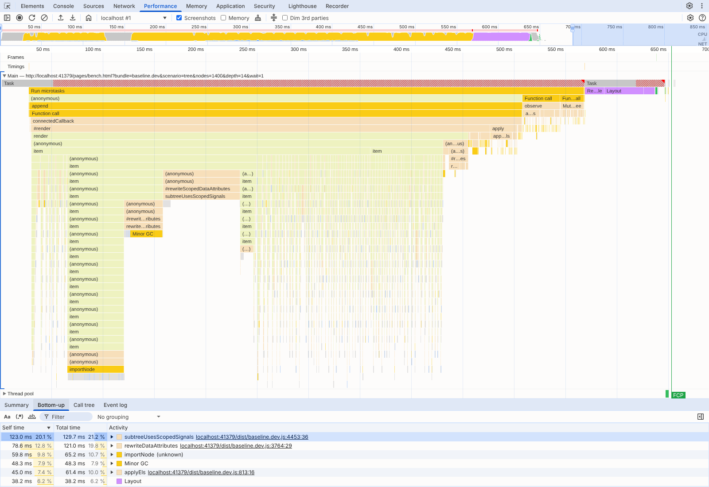
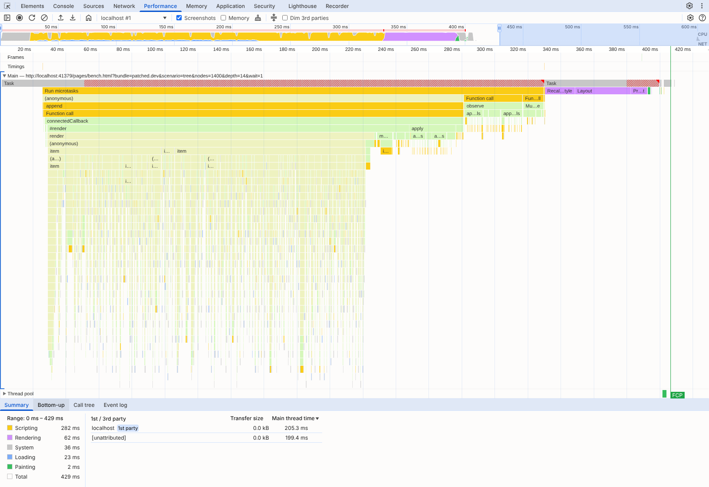
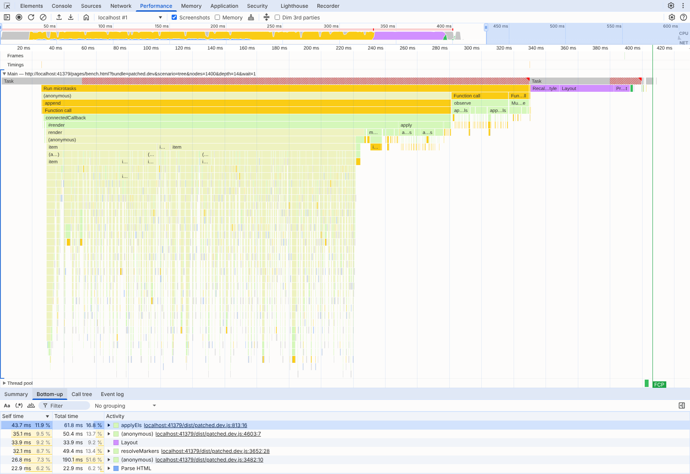

# Rocket render performance: two fixes, measured

This branch makes two small changes to Rocket (`library/src/rocket/`). Together they make first renders of large Rocket components 1.5–11x faster, and the DOM they produce is unchanged. This folder holds the benchmark, the correctness check, raw results and DevTools screenshots behind that claim. Every number can be rerun with the commands at the end.

## The two changes

**1. `template.ts`: nested `html` templates are no longer re-walked at every level.** Each `html` call composes its values into its own fragment and then postprocesses the whole fragment. Postprocessing covers `resolveMarkers`' text-node walk, plus `rewriteDataAttributes` and `subtreeUsesScopedSignals` via the component's postprocess. Postprocessing runs after children built by inner `html` calls are already inside, so a tree of templates N levels deep walks its deepest nodes N times. The fix inserts values that this same tagged literal produced *after* postprocessing; it tracks these in a per-literal `WeakSet` of the top-level nodes it returned. Those values were already postprocessed by their own call. Any other `Node`, such as one made with `document.createElement`, is still inserted first and postprocessed as before, so its `$$` bindings are still scoped (see the check below).

**2. `runtime.ts`: the pending-host `MutationObserver` no longer re-walks the parent's subtree on every mutation.** For each `childList` record it walked the added nodes and then `record.target` with all its descendants. When `data-for` stamps 400 rows into one `<tbody>`, every row insert re-walks the whole growing `<tbody>`, which is quadratic. The added nodes are still walked, and the target's other descendants were walked when they were added. The fix therefore walks only the target element itself (`markPendingRocketHosts(record.target, false)`).

## Results

Render time in ms, median (min–max) of 7 runs; speedup = baseline ÷ patched medians.

| Scenario | CPU | Baseline | Fix 1 only (template) | Fix 2 only (observer) | Both (patched) | Speedup |
| --- | ---: | ---: | ---: | ---: | ---: | ---: |
| tree, 1,400 items, depth 1 | 1x | 198 (153–231) | 165 (151–240) | 165 (142–190) | 149 (138–204) | 1.3x |
| tree, 1,400 items, depth 2 | 1x | 214 (190–302) | 207 (171–269) | 199 (172–258) | 215 (202–259) | 1.0x |
| tree, 1,400 items, depth 4 | 1x | 261 (230–348) | 260 (185–269) | 253 (204–325) | 232 (174–245) | 1.1x |
| tree, 1,400 items, depth 8 | 1x | 387 (260–436) | 257 (193–290) | 320 (254–398) | 231 (187–295) | 1.7x |
| tree, 1,400 items, depth 14 | 1x | 399 (339–532) | 249 (213–309) | 318 (275–448) | 260 (209–295) | 1.5x |
| tree, 1,400 items, depth 28 | 1x | 467 (421–550) | 249 (225–363) | 434 (408–717) | 250 (216–347) | 1.9x |
| tree, 1,400 items, depth 14, toggles | 1x | 900 (738–1,081) | 713 (594–863) | 861 (776–1,080) | 623 (555–696) | 1.4x |
| data-for, 100 rows x 7 cells | 1x | 281 (250–384) | 259 (243–360) | 138 (119–167) | 131 (120–177) | 2.1x |
| data-for, 200 rows x 7 cells | 1x | 684 (629–952) | 732 (647–868) | 241 (226–341) | 244 (223–297) | 2.8x |
| data-for, 400 rows x 7 cells | 1x | 2,579 (2,236–3,011) | 2,568 (2,322–2,720) | 472 (396–518) | 436 (388–530) | 5.9x |
| data-for, 800 rows x 7 cells | 1x | 9,319 (8,460–9,670) | 9,017 (8,511–9,853) | 890 (778–967) | 861 (737–951) | 10.8x |
| tree, 1,400 items, depth 14 | 4x | 1,514 (1,410–1,863) | 956 (902–1,051) | 1,362 (1,207–1,710) | 935 (849–1,030) | 1.6x |
| tree, 1,400 items, depth 14, toggles | 4x | 4,211 (3,533–4,552) | 3,032 (2,856–3,441) | 4,131 (3,535–4,476) | 2,851 (2,719–2,906) | 1.5x |
| data-for, 400 rows x 7 cells | 4x | 11,296 (10,404–12,103) | 11,729 (10,595–12,125) | 2,317 (2,109–2,695) | 2,143 (2,007–2,507) | 5.3x |

- **Builds:** `build.mjs` builds all four with the same esbuild settings. Baseline is `library/src` at `origin/develop` (1efcdc3, Datastar v1.0.4 + Rocket beta.2). Each fix alone is the baseline plus that one file.
- **Runs:** the four builds are interleaved, with the order alternating every round, and each run uses a fresh browser context.
- **Timing:** each run times from just before the component's host is inserted to the first animation frame after every item is in the DOM.
- **Scenarios:**
  - **tree:** 1,400 items, each its own `html` call, nested `depth` levels (a threaded comment page). The `toggles` variant gives every item with children a Rocket-local signal and three bindings.
  - **data-for:** a `<template data-for>` table with a nested `data-for` of 5 cells per row (a live table).
- **Environment:** see `results/env.json`: Chromium 153, an Intel Xeon at 2.10 GHz with 4 cores, Linux. Raw runs are in `results/runs.jsonl`.

What the table shows: fix 1 carries the tree, where the gain grows with depth, from noise at depth 1–4 to 1.9x at depth 28. Fix 2 carries `data-for`, where the gain grows with row count, from 2.1x at 100 rows to 10.8x at 800. Neither fix slows the other's scenario.

## Where the time goes

From `profile.mjs`: one render per scenario, profiled by V8 on unminified builds, with the same renders recorded as Chrome traces (`profiles/*.trace.json`, not committed; rerun to regenerate).

### tree, 1,400 items, depth 14

One render, unthrottled, unminified builds (render time 372.7 ms baseline, 301.8 ms patched). Total time (ms) in each function and everything it calls:

| Function | Baseline | Patched |
| --- | ---: | ---: |
| `resolveMarkers` | 70 | 37 |
| `rewriteDataAttributes` | 76 | 17 |
| `subtreeUsesScopedSignals` | 48 | 10 |
| `#rewriteScopedDataAttributes` | 127 | 29 |
| `markPendingRocketHosts` | 19 | 8 |
| `#render` | 275 | 209 |
| `apply` | 22 | 25 |

Top self time (ms), baseline:

| Function | Baseline | Patched |
| --- | ---: | ---: |
| `rewriteDataAttributes` | 75 | 17 |
| `subtreeUsesScopedSignals` | 48 | 10 |
| `resolveMarkers` | 46 | 28 |
| `applyEls` | 39 | 45 |
| `markPendingRocketHosts` | 16 | 7 |
| `appendChild` | 14 | 17 |
| `closest` | 12 | 17 |
| `importNode` | 11 | 17 |
| `#indexActionHosts` | 5 | 7 |
| `#rewriteScopedDataAttributes` | 3 | 2 |

### data-for, 400 rows x 7 cells

One render, unthrottled, unminified builds (render time 3420 ms baseline, 656.7 ms patched). Total time (ms) in each function and everything it calls:

| Function | Baseline | Patched |
| --- | ---: | ---: |
| `rewriteDataAttributes` | 46 | 42 |
| `#rewriteScopedDataAttributes` | 1 | 1 |
| `markPendingRocketHosts` | 2615 | 33 |
| `initRocketFors` | 177 | 153 |
| `#render` | 3 | 3 |
| `apply` | 181 | 166 |

Top self time (ms), baseline:

| Function | Baseline | Patched |
| --- | ---: | ---: |
| `markPendingRocketHosts` | 2202 | 29 |
| `querySelectorAll` | 259 | 10 |
| `MutationObserver.observe.subtree` | 175 | 29 |
| `get` | 169 | 11 |
| `applyEls` | 85 | 79 |
| `compileExpression` | 83 | 66 |
| `applyAttributePlugin` | 48 | 46 |
| `update2` | 39 | 41 |
| `observe` | 32 | 42 |
| `rewriteDataAttributes` | 29 | 23 |


## Screenshots: Chrome DevTools, Performance panel

`screenshots.mjs` opens Chromium's own DevTools frontend and loads each trace through the panel's "Load trace…" button. It screenshots the flame chart and the Bottom-up view (self time per function). The traces are unthrottled renders of the unminified builds.

**data-for, 400 rows: baseline.** `markPendingRocketHosts` dominates the long `MutationObserver` task.




**data-for, 400 rows: patched.** The same render finishes in about a quarter of the time, and the observer task is small.




**tree, 1,400 items, depth 14: baseline.** `rewriteDataAttributes`, `subtreeUsesScopedSignals` and `resolveMarkers` lead self time.




**tree, 1,400 items, depth 14: patched.** Layout and Datastar's `applyEls` lead; the template walks have dropped down the list.




## Correctness

`check.mjs` (output in `results/check.txt`: 45 passed) runs every build against the baseline:

- **Same DOM:** every benchmark scenario (tree at depth 1 and 14, with and without signals, and `data-for` rows) gives a byte-identical `innerHTML`.
- **Composition cases** (`pages/check.js`), each giving the same results and DOM as the baseline:
  - nested templates with local signals at every level;
  - a `Node` made with `document.createElement` carrying `$$` bindings, which must still be scoped and reactive;
  - an iterable mixing template output with such a node;
  - `svg` output inside `html`;
  - a second `render()` that morphs;
  - component hosts in the page before their component is defined, both inserted as markup and with a child appended later.

An earlier, simpler version of fix 1 deferred *every* composed node. That stopped scoping nodes made outside the template, and the foreign-node case caught it. That is why fix 1 tracks the nodes its own literal produced. The repo has no test suite to run beyond this.

## Compared with the fix proposed in #1227

[starfederation/datastar#1227](https://github.com/starfederation/datastar/issues/1227) reports the same observer function from another angle: reordering rows with `replaceChildren`. It proposes a different fix: skip removal-only records, and walk each parent once per batch. `patches/issue-1227.patch` is that diff. `build.mjs` builds it as `issue-1227`, and `check.mjs` checks it like the others (it passes). `compare-1227.mjs` times it against fix 2 on this benchmark's `data-for` rows and on the issue's own reproduction (`pages/reorder.html`):

Time in ms, median (min–max) of 7 runs. data-for: render, as in summary.md. Reorder: one replaceChildren of the same rows, reversed, until the observers have run (the issue's own reproduction).

| Scenario | Baseline | #1227's change | This branch's change |
| --- | ---: | ---: | ---: |
| data-for, 100 rows x 7 cells | 281 (223–335) | 136 (110–184) | 152 (117–194) |
| data-for, 400 rows x 7 cells | 2,316 (2,106–2,643) | 446 (386–464) | 419 (395–625) |
| data-for, 800 rows x 7 cells | 9,693 (9,458–10,526) | 948 (811–1,016) | 918 (793–1,150) |
| #1227 reorder, 250 rows x 8 cells | 269 (237–450) | 31 (15–34) | 34 (30–51) |
| #1227 reorder, 500 rows x 8 cells | 1,018 (860–1,129) | 70 (55–95) | 81 (55–90) |
| #1227 reorder, 1000 rows x 8 cells | 3,940 (3,467–4,178) | 117 (105–160) | 125 (106–178) |

The two changes perform the same within noise on both workloads. Either one fixes both cases.

## Rerun

```sh
cd bench/rocket-perf
npm install            # esbuild, playwright (then: npx playwright install chromium)
node build.mjs         # dist/: baseline, template-only, observer-only, patched, issue-1227
node check.mjs         # correctness
node run.mjs 7         # results/summary.md, runs.jsonl, env.json
node profile.mjs       # results/profile.md, profiles/*.trace.json
node screenshots.mjs   # results/flame-*.png, bottom-up-*.png
node compare-1227.mjs  # results/compare-1227.md
```

`pages/repro-nested.html` is a standalone page for fix 1 that loads the v1.0.4 bundle from jsDelivr and can be pasted into CodePen. It renders the same 1,400 items 1 and 28 templates deep and logs both times.

## Attribution

These changes and measurements came out of benchmarking Datastar as a single-page app against Solid in [derekr/solid-server-component-benchmarks](https://github.com/derekr/solid-server-component-benchmarks). There, these two hot spots were the largest costs in a Rocket-rendered Hacker News thread and a live `data-for` table. Claude (Anthropic's model, in Claude Code) found the hot spots, wrote the fixes and this benchmark, and took the measurements on 2026-10-24, at the request of Derek ([@derekr](https://github.com/derekr)). The numbers are from one 4-core cloud VM, so treat absolute times as indicative; the ratios are the claim.
